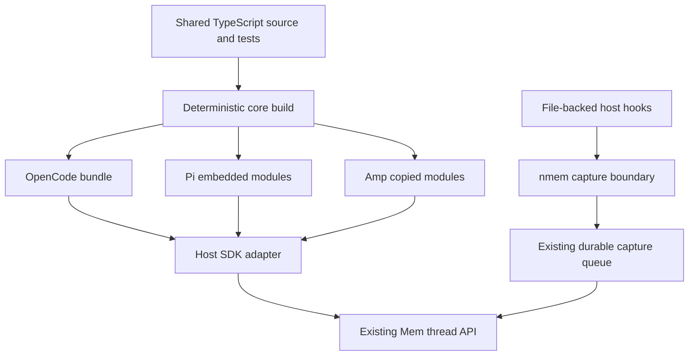

# Shared Plugin Core Specification

Status: Phase one merged; phase-two OpenClaw adoption proposed; publication and live host acceptance remain separate

Date: 2026-10-16

Inspected Community baseline: `d6e546efe17c9ba48291a67356c4be6f7a7883a8`

Phase-two baseline: `b868af865262ac2e9f469bb62f6b8223c22ea846`.

Phase two adds OpenClaw as a direct consumer of core `0.2.0`. It shares prefix
hashing, safe persistence-count validation, and sync timeout parsing. Its
snapshot selector remains host-owned: shortened snapshots re-anchor locally
without replaying pre-compaction history, and legacy count-only cursors remain
supported. Its flat/nested create responses and count aliases are normalized
in the adapter before using the shared create-acknowledgement check. Both npm
and ClawHub artifacts receive independent core receipts. Existing consumers
refresh embedded manifests and patch plugin versions in the same change.

## 1. Decision

Create an internal TypeScript package at `shared/plugin-core`. Maintain shared
algorithms there and embed its generated JavaScript into each consuming plugin
at build time. Continue distributing plugins through their existing channels,
with independent plugin versions. Do not publish a new public core package in
the first phase.

Start with acknowledged snapshot deltas, persistence acknowledgement validation,
and thread-sync timeout parsing for OpenCode, Pi, and Amp. Keep host lifecycle,
message extraction, transport, configuration, and tool registration in adapters.
Keep file-backed transcript capture and its durable queue in `nmem`.

The language decision applies to new shared plugin logic. Existing Rust CLI
implementation and host-required Python entrypoints remain their native
boundaries; reproducing that business logic in TypeScript would defeat reuse.

## 2. Problem and intended outcome

Several connectors independently implement prefix hashing, cursor selection,
checkpoint acknowledgement checks, and timeout parsing. A fix can reach one host
while another retains an older algorithm. Behavioral instructions can also drift
even when plugins expose similar tool names.

The intended outcome is one implementation and one conformance suite for each
genuinely shared behavior, plus small host adapters that preserve real host
capabilities. A shared change must identify and validate every affected adapter
before merging. Published artifacts must expose which core revision they contain.

Capability consistency means equivalent contracts when a host supports a
capability. It does not mean pretending that startup context injection, guided
search, automatic query retrieval, and automatic transcript capture are the same
feature. Model behavior cannot be guaranteed solely by sharing instructions.

### Goals

- Write new shared implementation, build tooling, and core tests in TypeScript.
- Preserve published tool names, thread identities, routing, and capture privacy.
- Reduce repeated algorithms without introducing a general plugin framework.
- Keep installation independent of the Community checkout and core build tools.
- Make embedded versions, affected consumers, and release evidence reviewable.
- Allow independent plugin releases without a core-first publication sequence.

### Exclusions from the first phase

- Rewriting all plugins or introducing a root npm workspace.
- Replacing `nmem`, its durable capture queue, or its backend protocol.
- Centralizing HTTP clients, retries, lifecycle scheduling, or cursor persistence.
- Changing install commands, registry schema, or host SDK entrypoints.
- Requiring Node for currently Python/shell-only hosts.
- Publishing npm, PyPI, ClawHub, or marketplace artifacts as part of this spec.

## 3. Existing boundaries and evidence

| Area | Current implementation | Consequence |
| --- | --- | --- |
| OpenCode | [Snapshot helpers](../nowledge-mem-opencode-plugin/src/session-delta.ts), [timeout helper](../nowledge-mem-opencode-plugin/src/thread-sync-timeout.ts), bundled `dist/index.js` | Suitable first consumer; preserve bundle entrypoint. |
| Pi | [Snapshot helpers](../nowledge-mem-pi-package/extensions/session-delta.ts), host-loaded TypeScript extension | Embed generated modules beside the extension. |
| Amp | [Snapshot helpers](../nowledge-mem-amp-plugin/src/session-delta.ts), TypeScript entrypoint, [copy installer](../nowledge-mem-amp-plugin/scripts/install.sh) | The copied plugin directory must include the core. npm metadata is not proof of an npm release channel. |
| OMP | [Wrapper](../nowledge-mem-omp-plugin/extensions/nowledge-mem.ts) imports Pi and sets process environment; package depends on Pi with a version range | A Pi change also affects OMP. Validate this transitive consumer without rewriting its adapter in phase one. |
| OpenClaw | [Snapshot delta](../nowledge-mem-openclaw-plugin/src/session-delta.js) treats a shortened snapshot as host compaction | Exclude its delta algorithm until compaction semantics have an explicit contract. |
| DeepSeek Harness | [Event delta](../nowledge-mem-deepseek-harness-plugin/src/session-delta.js) uses sequence anchors and CLI import acknowledgements | Event streams are a different algorithm from snapshots. |
| File-backed hooks | `nmem` owns discovery, capture intake, durable work, and upload scheduling | Share the CLI boundary rather than introduce another plugin-side queue. |
| Guidance and metadata | [Behavioral guidance](../shared/behavioral-guidance.md), [integration registry](../integrations.json) | Reuse canonical guidance; registry remains authoritative for capabilities and versions. |

Existing snapshot implementations are similar but not interchangeable. Amp and
OpenCode use different destination-key encodings and response classifiers, and
their acknowledgement validators differ in strictness. Extraction must record
these differences before choosing common behavior.

The [development guide](PLUGIN_DEVELOPMENT_GUIDE.md) still gates migration to
`nmem hook capture` on a shipped minimum CLI version. Availability in source or
on a maintainer machine does not establish that release floor.

## 4. Architecture and ownership



| Owner | Responsibilities |
| --- | --- |
| Shared core | Pure delta selection, prefix hashing, acknowledgement parsing, bounded timeout parsing. |
| Host adapter | SDK events, transcript/message projection, stable external IDs, thread ID construction, destination resolution, privacy eligibility, HTTP/CLI calls, recovery policy, persistence, user-visible output. |
| `nmem` | File-backed session capture, durable queue, coalescing, worker leases, and upload processing. |
| Build tooling | Generate embedded modules, validate freshness, enumerate consumers, emit content manifests. |
| Release tooling | Validate plugin metadata, pack reviewed files, publish selected channels, bind receipts to source and artifact hashes. |

The core must not read environment variables, mutate process globals, register
SDK hooks, discover credentials, perform I/O, or own background tasks. Explicit
arguments and callbacks carry host data. Core imports may use Node built-ins,
such as `node:crypto`, but must not depend on a host SDK.

The initial package layout is proposed as:

```text
shared/plugin-core/
  package.json                 # private: true
  package-lock.json
  tsconfig.json
  consumers.json               # build inputs and consumer dependency edges
  src/
    index.ts
    thread-delta.ts
    acknowledgement.ts
    timeout.ts
  scripts/
    build.ts                   # generation and --check freshness validation
    consumers.ts
    receipt.ts
  tests/
    thread-delta.test.ts
    acknowledgement.test.ts
    timeout.test.ts
    fixtures/
```

`consumers.json` describes embedding paths, output format, and transitive build
dependencies. It must not duplicate install commands or capability metadata from
`integrations.json`. Only registered consumers receive generated output.

## 5. Initial contracts

### 5.1 Acknowledged snapshot delta

The common selector accepts an ordered snapshot, an optional acknowledged cursor,
and adapter-provided external-ID and message-fingerprint functions. It returns
the unacknowledged suffix, a candidate cursor, and whether the prior prefix was
invalidated. It does not persist that candidate.

- Trust a cursor only when its count is valid, its last external ID matches, and
  the acknowledged prefix fingerprint is unchanged.
- Detect same-length replacements and edits earlier than the last message.
- Preserve existing length-framed UTF-8 SHA-256 prefix hashing. Do not change
  fingerprint fields, JSON encoding, or message ordering during extraction.
- Preserve host thread IDs exactly, including case. Host-specific thread ID and
  destination-key constructors remain in adapters in phase one.
- Keep local snapshot count distinct from acknowledged remote thread length.
- Advance stored state only after the adapter validates persistence evidence.
- Leave checkpoint conflict, missing-thread recovery, and retry sequencing with
  the adapter. A selected suffix alone is not a persistence acknowledgement.

The snapshot contract initially retains full reconciliation when a trusted prefix
is lost. OpenClaw's compaction shrink rule and DeepSeek Harness's sequence-anchor
rule require separate named contracts before adoption; a generic boolean switch
must not erase their differences.

### 5.2 Persistence acknowledgement

Shared parsers return validated information or a rejected result. HTTP success
alone is insufficient.

- Append acknowledgement requires explicit success and integer, nonnegative
  message counts. A checkpointed append additionally requires the expected
  `append_mode`.
- Create acknowledgement must identify the expected thread. Any compatibility
  fallback to a returned message array must be explicit and covered by fixtures.
- Missing fields, malformed bodies, and unknown response shapes cannot advance
  the cursor.
- A request context remains bound to its original destination lane. Switching
  endpoint, credentials, Space, AI Identity, or host-agent identity cannot reuse
  another lane's cursor or apply its acknowledgement.
- Preserve retry idempotency after an uncertain response. An upload may have
  committed even when the client did not receive its acknowledgement.

Adapters retain host-specific HTTP error classification. For example, a textual
"not found" response must not acquire broader retry semantics as a side effect
of extracting a validator.

Some existing validators accept negative or unsafe integers. Tightening those cases is an
intentional correctness change, not semantic equivalence. Separate that change
from mechanical extraction, or identify it explicitly with regression fixtures
and release notes. Do not copy the least strict implementation as the standard.

### 5.3 Thread-sync timeout

Keep the existing shared interpretation: default 120,000 ms, minimum 1,000 ms,
maximum 1,800,000 ms. Blank, invalid, unsafe, fractional, zero, or negative values
use the default; valid positive integers clamp to the bounds. The adapter reads
configuration and passes the raw value to the core.

### 5.4 Behavioral consistency

A later phase may generate bounded instruction fragments from
`shared/behavioral-guidance.md`. Host-specific frontmatter, hook responses, tool
names, and placement remain adapter-owned. Never load instructions from a remote
URL at plugin startup merely to keep them current.

Conformance must distinguish startup context, proactive retrieval, guided search,
distillation, and real transcript capture using existing registry metadata.
Unsupported host capabilities remain explicitly unsupported. Shared prompts and
static assertions complement actual host acceptance; they cannot replace it.

## 6. Distribution decision

| Option | Benefits | Costs and risks | Decision |
| --- | --- | --- | --- |
| Internal source package, embedded during build | One source implementation; standalone plugin payloads; works with npm and Git/copy delivery; no additional runtime publisher | Generated copies need freshness checks; fixes require releasing affected plugins | Use first. |
| Public npm core package used at runtime | Independent package lifecycle; external consumers can install it | Additional install dependency, publisher configuration, compatibility matrix, and release ordering; poor fit for copied hooks and native Python hosts | Reconsider only when an external consumer needs a supported API. |

Publishing a public npm package later does not require switching plugins to
runtime resolution. Consumers may still pin and bundle its exact contents.
`file:`, workspace links, symlinks to `../../shared`, and moving Git dependencies
must not appear as runtime requirements of shipped consumers.

### 6.1 Embedded artifact format

Produce one ESM JavaScript core entry and TypeScript declarations. For source
loaded by a host, place them under a plugin-local generated directory, with an
explicit ESM package boundary where the surrounding package lacks `type: module`.
Only generated JavaScript is executed for shared logic; the host may continue
loading its existing TypeScript adapter.

Proposed destinations:

| Consumer | Generated location | Delivered form |
| --- | --- | --- |
| OpenCode | `src/generated/plugin-core/` | Core bundled into existing `dist/index.js`; content manifest included in npm files. |
| Pi | `extensions/generated/plugin-core/` | JavaScript, declarations, module metadata, and content manifest included in the npm tarball. |
| Amp | `src/generated/plugin-core/` | Same files committed beside the adapter and included by Git/copy installation. |
| OpenClaw | `src/generated/plugin-core/` | ESM, declarations, and manifest included in both npm and ClawHub tarballs; compaction and cursor compatibility remain in the adapter. |

Commit generated consumer files so checkout-based installs remain usable without
build tools. Generated files carry a regeneration notice and must never be edited
directly. CI regenerates them with locked dependencies and rejects a difference.
For OpenCode, regenerate the core before rebuilding and checking the existing
committed bundle.

Compilation target must support the lowest verified runtime of each consumer.
Node 24 in publishing CI is a build environment, not an implied Node 24 runtime
requirement. The implementation proof must exercise each supported host loader,
including Pi's extension loader and Amp's copied entrypoint.

No core download, compiler installation, or build lifecycle script runs during
end-user installation. Existing SDK dependencies keep their own contracts.
Independence here means the common core needs no runtime package or parent repo.

### 6.2 Versions and provenance

The internal core has its own version, initially proposed as `0.1.0`. Change
that version when its shipped implementation or internal API changes. Record
breaking contracts explicitly even while the version is below 1.0.

Each embedded content manifest records:

- Manifest format version and core version.
- Deterministic SHA-256 digest of normalized core source and build inputs.
- Hashes of generated module and declaration files.
- Output format and build-tool versions.

Hash canonical relative paths and file contents in sorted order; exclude generated
outputs from source inputs and exclude the manifest from its own file hashes.
Do not embed timestamps, local paths, credentials, or a hash of a credential-bound
destination lane.

The checked-in manifest uses content digests rather than the containing commit
SHA, avoiding a self-referential commit. An external release receipt adds the
full reviewed Community SHA, plugin name/version, core manifest, and final
artifact integrity. A manifest is descriptive metadata; provenance requires
binding it to the reviewed build and the exact delivered artifact.

Plugin versions remain independent. Every plugin payload changed for a release
requires a new plugin version and synchronized registry, manifest, changelog,
lockfile, and active version pins. An internal core version is not a new
integration entry and requires no registry schema change.

One merge can migrate several plugins without publishing them simultaneously.
Track each plugin's delivered core version in release receipts; do not claim a
fix reached all hosts merely because shared source merged. If a common fix is
urgent, identify the required release cohort and finish every selected channel.

OMP and Step Code currently resolve Pi through version ranges. A new Pi release can affect
them without new wrapper artifacts. Include both in Pi compatibility validation and
record this exception to independently frozen payloads. Do not promise exact
transitive core pinning until OMP's dependency contract is deliberately changed.

## 7. Build, CI, and release procedure

Follow the existing [publishing runbook](PLUGIN_PUBLISHING.md) and
[plugin-release skill](../.agents/skills/plugin-release/SKILL.md). This spec adds
embedded-core checks; it does not authorize publication or bypass release gates.

### 7.1 Pull-request checks

1. Install locked core build dependencies, typecheck, and run shared fixtures.
2. Generate every registered consumer and reject stale checked-in output.
3. Run affected adapter suites, including transitive consumers such as OMP and Step Code.
4. Build or copy each delivery payload and check it outside the repository.
5. Validate registry and version-bearing surfaces for selected releases.

Initially run all registered core consumers for any `shared/plugin-core/**`
change; the small matrix is safer than premature selective test scheduling.
Changes to build scripts or consumer metadata trigger the same matrix. Update
OpenCode, Pi/Codex, and release-contract path filters so a shared-only change
cannot skip their checks. Add focused Amp validation rather than assume an npm
publisher supplies it.

Avoid weakening source-text tests just because code moved. Replace algorithm
assertions with behavioral fixtures where appropriate; retain static assertions
that protect installer, metadata, privacy, or exposed-tool contracts.

### 7.2 Package preparation and publication

| Consumer | Existing delivery | Required integration |
| --- | --- | --- |
| OpenCode | `publish-opencode.yml` | Build/check the embedded core before existing bundle validation and packing; retain bundle freshness checks. |
| Pi | `publish-npm-plugins.yml`, selector `pi` | Add explicit core generation/check before tests and packing; current pack flow does not supply this build step. |
| OpenClaw | `publish-npm-plugins.yml`, selector `openclaw`; `publish-clawhub.yml` | Check generated core, then retain each channel's original tarball, pack metadata, and core receipt. |
| Amp | Git Personal Plugins and local copy installer | Commit generated payload; verify copied folder and manifest. Do not add Amp to npm publishing solely because it has `package.json`. |
| OMP | `publish-npm-plugins.yml`, selector `omp` | Qualify its resolved Pi release with the existing wrapper; no direct core embedding yet. |

The core remains `private: true` and is not added to publisher allowlists.
Install its build dependencies explicitly; release workflows currently use
`npm ci --ignore-scripts`, so generation must not depend on install hooks.

For each authorized release:

1. Update the selected integration's registry entry first, then synchronize every
   active version-bearing surface in the same release PR.
2. Merge the reviewed source and record its full 40-character main SHA. Dispatch
   the existing allowlisted workflow with that exact SHA and version.
3. Regenerate and verify core output, run consumer validation, then pack once.
   A build discrepancy blocks upload rather than silently repairing the payload.
4. Publish the tested tarball through the established Trusted Publisher identity.
   Retain the tarball, existing pack receipt, and embedded-core release receipt.
5. Read back published integrity and version/latest, then qualify a disposable
   host installation of that exact artifact. Report host acceptance separately.

For copied Amp delivery, record the reviewed source SHA and payload file hashes,
then verify the installed copy in a disposable profile. No npm receipt exists
unless a separate npm distribution contract is introduced.

OpenClaw adoption later must preserve its separate npm and ClawHub publications
and their independent receipts, including ClawHub's workflow/source SHA rules.
PyPI adoption must preserve exact wheel/sdist evidence. Shared core adoption does
not change either channel's authorization or acceptance contract.

The existing verification-only recovery path should retain and validate the
original core receipt along with `pack.json`. Registry publication that succeeded
before verification failed must not be retried as another upload. A local rebuild
cannot replace missing evidence of the originally published artifact.

### 7.3 Artifact isolation

Extract npm tarballs into temporary roots and copy Amp's delivered directory into
a disposable host profile. Remove access to the parent checkout and development
dependencies for the runtime check. Resolve any required SDK through the supported
host mechanism, not a monorepo link.

Verify that entrypoints resolve embedded modules, manifest hashes match, all
required declarations and module metadata are included, and no runtime import
escapes the delivered directory to reach `shared/plugin-core`. Loading an isolated
module is packaging evidence; real SDK lifecycle behavior needs host acceptance.

For a future separate-repository consumer such as Gemini, embed a reviewed core
snapshot and its content manifest into that repository. Build and install from
that repository alone. Record the origin Community SHA separately; a parent
submodule pointer or relative parent import is not a distribution mechanism.
Gemini migration is outside the first phase.

## 8. Validation matrix

| Contract | Required coverage |
| --- | --- |
| Delta selection | Initial snapshot, unchanged snapshot, append, same-length replacement, earlier-prefix edit, missing anchor, invalid cursor, empty snapshot, UTF-8 framing. |
| Acknowledgements | Missing success/count/mode, negative and fractional counts, wrong create thread, zero-message idempotent replay, malformed response, server commit followed by lost response. |
| Adapter recovery | Checkpoint conflict, confirmed missing-thread recreation, unrelated failures that must not recreate, retry without premature cursor advancement. |
| Routing | Endpoint, credential, Space, AI Identity, and host-agent changes isolate cursor state; preserve existing lane encoding and case-sensitive session IDs. |
| Timeout | Unset, blank, nonnumeric, unsafe integer, fractional, zero, negative, below minimum, normal value, above maximum. |
| Privacy and lifecycle | Disabled automatic capture, host incognito/private mode, hook failure budget, session switch, resume failure behavior; no new fallback that uploads forbidden content. |
| Delivery | Deterministic generation, stale-output rejection, manifest verification, npm tarball contents, Amp copied entry, Pi/OMP/Step Code loader compatibility, runtime without parent checkout. |
| Capabilities | Existing startup/search/distill/status and thread-save contracts; distinguish guided behavior from deterministic automatic actions. |

During extraction, run old and new algorithms against the same host fixtures.
Any result difference must be explained by a separately reviewed behavior change.
Retain host adapter tests for scheduling and recovery; core tests alone do not
exercise their state machines.

Relevant existing checks to retain during implementation include:

```sh
npm --prefix nowledge-mem-opencode-plugin test
npm --prefix nowledge-mem-opencode-plugin run check
node --test nowledge-mem-pi-package/tests/*.test.mjs
npm --prefix nowledge-mem-amp-plugin test
npm --prefix nowledge-mem-amp-plugin run typecheck
python3 -m pytest tests/plugin_e2e/test_key_plugins_e2e.py -q
python3 -m unittest discover -s scripts -p 'test_plugin_release.py' -v
```

Add shared-package generation, core tests, and artifact isolation commands with
the implementation. This document does not assert these checks have run.

## 9. Staged implementation

| Stage | Scope and tradeoff | Entry condition | Exit condition and evidence |
| --- | --- | --- | --- |
| A: Proof | Tiny core package; generated module loaded by OpenCode, Pi, and Amp. Verify module and declaration compatibility before moving business logic. | Spec decisions selected; existing SDK/runtime support inventory recorded. | Locked build produces deterministic JS/declarations; all three delivered layouts load without parent imports. Stop if a loader cannot consume the format. |
| B: OpenCode extraction | Move the three shared modules; retain local identity, classifiers, transport, and recovery. | Stage A passes; old/new fixture differences classified. | Core and adapter contracts hold; bundle and isolated tarball contain the reviewed core. |
| C: Pi and Amp extraction | Reuse the same contracts; keep host projections and lifecycle state machines. Validate OMP and Step Code transitively. | OpenCode demonstrates the boundary; consumer build paths established. | Independent Pi artifact and Amp copy load; parity fixtures, routing/privacy checks, and Pi/OMP/Step Code compatibility pass. |
| D: Release qualification | Synchronize selected plugin versions and extend existing publishers/receipts. Preserve independent release channels. | Generated payloads, affected-consumer CI, and metadata are reviewable. | Ready-to-publish artifacts bound to reviewed source; actual publication and host readback occur only within an authorized release task. |
| E: Wider consistency | Generate behavioral fragments; evaluate OpenClaw/DSH algorithms and native hooks separately. | First consumers accepted; additional host semantics documented. | Each new adoption has its own runtime, capability, and release proof. No generic sync engine introduced by assumption. |

Each stage can be a bounded PR. A core fix propagates through regenerated payloads
and explicit consumer releases, not an unreviewed startup update. No changes to
the existing integration registry or release versions are required to land this
spec alone.

## 10. Risks, rollback, and deferred decisions

- **Generated drift:** block stale payloads in CI and publisher preparation; use
  one generator and verify delivered file hashes.
- **False equivalence:** preserve lane encodings and host projection rules;
  isolate acknowledgement hardening and compaction changes from extraction.
- **Mixed versions:** track per-plugin delivered core receipts and verify the
  selected release cohort. Independently installed hosts can temporarily differ.
- **Hidden transitive upgrades:** include OMP and Step Code whenever Pi changes; an exact Pi
  dependency or a shared adapter factory is a separate compatibility decision.
- **Runtime mismatch:** prove host loaders first. For Claude/Codex and other
  command-hook hosts, choose runtime discovery or an executable distribution
  only after verifying host availability, installation size, and offline behavior.
- **CLI rollout gap:** establish a tested, publicly shipped minimum CLI before
  requiring `nmem hook capture`; retain the existing compatibility capture path
  until that gate is met. Never implement a second durable queue to bridge it.

Rollback a source migration with a normal forward revert and regenerate the
affected payloads. An already published version is immutable: ship a new plugin
version containing the corrected or previously known-good core. Do not overwrite
an artifact or downgrade `latest`. A user may explicitly pin a prior compatible
plugin version. Rollback must preserve host thread IDs, capture state, and routing
formats so it does not create duplicate threads or cross destination lanes.

Public core publication, full hook-language convergence, OMP adapter decoupling,
and the shipped CLI floor remain later decisions. None blocks the proposed first
three TypeScript consumers or the build-time embedding approach.
